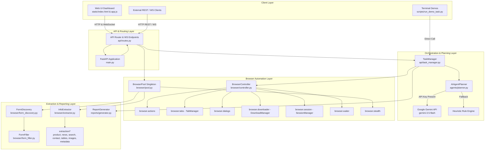
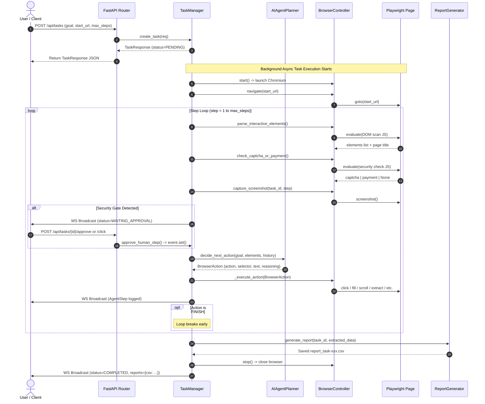

# System Architecture & Technical Design

This document describes the high-level architecture, module decomposition, execution lifecycle, and concurrency model of the **AI Browser Automation Agent**.

---

## 1. High-Level System Architecture

The system is organized into modular layers that separate API transport, agent planning, browser execution, structured extraction, and reporting:



---

## 2. Layer-by-Layer Architectural Breakdown

### 2.1. Presentation & API Layer (`main.py`, `api/routes.py`, `static/`)
- **FastAPI Application**: Exposes REST endpoints for task submission, manual approval, direct coordinate clicking, data extraction, form discovery, and report downloads.
- **WebSocket Streaming (`/api/ws/tasks/{task_id}`)**: Delivers real-time task progress, step descriptions, timing, and screenshot URLs to connected clients.
- **Web UI Dashboard**: Single-page frontend providing live task control, interactive approval modals, remote click forwarding, extraction JSON inspector, and form discovery views.

### 2.2. Task Management & Orchestration Layer (`api/task_manager.py`, `models/schemas.py`)
- **Task Lifecycle**: Controls task state transitions (`PENDING` -> `RUNNING` -> `WAITING_APPROVAL` -> `COMPLETED` / `FAILED` / `CANCELLED`).
- **Execution Loop**: Manages the step-by-step loop: DOM snapshotting -> security check -> screenshot capture -> planning -> action execution -> step logging -> WebSocket broadcasting.
- **Human-in-the-Loop Gating**: Detects security gates (CAPTCHAs/payments), pauses execution, captures full-context screenshots, and resumes execution upon user approval or coordinate click.

### 2.3. Multi-Agent Delegation
- **Master orchestrator**: TaskManager remains the parent authority and asks the configured planner for bounded specialist work during preflight and while the live task is executing.
- **Runtime delegation**: After a successful live DOM snapshot, the master may request up to two read-only specialists for that page. Delegation is deduplicated by URL and visible page structure, capped at six page attempts per task, and skipped on authentication pages.
- **Specialists**: Navigation, research, and interaction workers inspect a dedicated task tab and return bounded evidence. Recovery diagnoses failures; verification independently checks task outcomes; form workers may populate explicitly mapped fields but never submit.
- **Shared task evidence**: Sanitized specialist results are added to task context so the primary planner can use them on its next decision.
- **Mutation authority**: Specialists do not execute browser mutations during automatic runtime delegation. The main TaskManager executor re-inspects the current DOM and remains the only component that chooses and executes the user's browser actions. Existing approval and security gates remain authoritative.
- **Boundaries**: Runtime delegation uses the current validated URL, drops query parameters, preserves SPA fragments, avoids credentials/form values, and continues the parent task if specialist planning or execution fails.

### 2.4. AI Planning & Decision Engine (`agents/planner.py`) (`agents/planner.py`)
- **LLM-Driven Mode**: Sends structured prompts to Google Gemini containing the user goal, current DOM elements, headings, recent trajectory history, and plain-text user data. Enforces strict JSON output schema.
- **Deterministic Heuristic Mode**: Fallback rule engine that requires no external API keys. Handles domain selection, search typing with Enter submission, result extraction, scrolling, and finishing.

### 2.5. Browser Automation Core (`browser/`)
- **`BrowserController`**: Main Playwright browser lifecycle manager supporting Chromium, Firefox, and WebKit in headless or headed/maximized modes.
- **`browser.actions`**: Low-level interaction primitives (clicks, typing, dropdown selection, checkboxes, radios, drag-and-drop, scrolling).
- **`browser.tabs` (`TabManager`)**: Multi-tab lifecycle and popup interception (`wait_for_popup`).
- **`browser.dialogs`**: Native JavaScript dialog handlers (`alert`, `confirm`, `prompt`) and file chooser upload interceptors.
- **`browser.downloader` (`DownloadManager`)**: Playwright download event listener with collision-free unique file path resolution.
- **`browser.session` (`SessionManager`)**: Cookie, localStorage, viewport, geolocation, and custom HTTP header management.
- **`browser.waiter`**: Centralized async wait utilities (`wait_for_selector`, `wait_for_text`, `wait_for_navigation`, `settle_page`).
- **`browser.stealth`**: Anti-bot evasion scripts overriding `navigator.webdriver`, plugins, WebGL vendor, and permissions.
- **`BrowserPool`**: Singleton warm browser instance pool managing isolated contexts and pages for fast ad-hoc extraction and form discovery.

### 2.6. Information Extraction & Form Discovery (`browser/extractor.py`, `extraction/`, `browser/form_discovery.py`)
- **`InfoExtractor`**: Auto-detects content category via multi-signal scoring (URL, metadata, JSON-LD, DOM signals) and delegates to specialized extraction modules (`product`, `news`, `search`, `contact`, `tables`, `images`, `metadata`).
- **`FormDiscovery`**: Automatically inspects forms, identifies field types, infers human-readable labels via an 8-source priority chain, and fuzzy-maps fields to user data.
- **`FormFiller`**: Provides zero-config autofill alongside pre-built workflows for login, registration, job applications, and surveys.

### 2.7. Reporting Layer (`reports/generator.py`)
- **`ReportGenerator`**: Transforms extracted task findings into standardized tabular records and writes CSV reports to `reports/report_<task_id>.csv`.

---

## 3. End-to-End Task Execution Lifecycle

The diagram below illustrates the complete sequence of events when an automation task is submitted:



---

## 4. Concurrency, Event Loop & Scaling

### 4.1. Windows Asyncio Event Loop Policy
On Windows with Python 3.10+, Playwright requires subprocess creation within an active event loop. To avoid `NotImplementedError`, `main.py` explicitly sets the event loop policy before anything else imports or runs:

```python
if sys.platform == "win32":
    asyncio.set_event_loop_policy(asyncio.WindowsProactorEventLoopPolicy())
```

### 4.2. Browser Context Pooling (`BrowserPool`)
For one-off operations such as structured extraction (`POST /api/extract`) and form discovery (`POST /api/forms/discover`), spinning up a full browser process per request causes high latency. 

The `BrowserPool` maintains a single warm Playwright instance in memory and acquires isolated `BrowserContext` and `Page` objects wrapped in an async context manager:

```python
pool = await get_browser_pool()
async with pool.acquire_context() as (context, page):
    await page.goto(url)
    # Context is automatically cleaned up on exit
```

---

## 5. Security & Human-in-the-Loop Architecture

The system avoids breaking on bot verification barriers through automated security checks:

1. **Detection**: `BrowserController.check_captcha_or_payment()` inspects iframes and DOM elements for reCAPTCHA, hCaptcha, Cloudflare Turnstile, and payment/credit card inputs.
2. **Interception**: If detected, `AIAgentPlanner` issues a `REQUEST_APPROVAL` action, transitioning the task status to `WAITING_APPROVAL`.
3. **Remote Interaction**: The user can either complete the challenge directly on a headed browser window or interact through the Web UI via normalized coordinate clicks (`POST /api/tasks/{task_id}/click?x=0.5&y=0.5`), which translates percentages into exact viewport pixel mouse clicks.
4. **Resumption**: Calling `POST /api/tasks/{task_id}/approve` triggers the internal `asyncio.Event` to resume automated execution.


### 2.8. Live-tab specialist observation
Runtime navigation, research, and interaction specialists can inspect the exact task tab through the parent's existing extension adapter. They do not create duplicate tabs when this mode is enabled. A per-task async observation lock serializes their DOM snapshots, and workers receive no mutation API or permission to execute actions. The main TaskManager remains the sole browser-action executor and re-inspects the page before acting. If a parent adapter is unavailable or ownership does not match, the specialist fails closed rather than attaching to another task.
