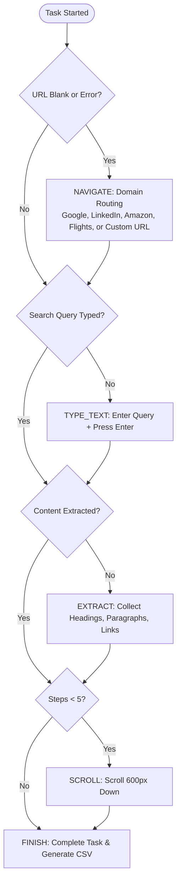

# AI Agent Planning & Execution Loop

This document describes the multi-step planning architecture, LLM integration, heuristic fallback engine, background execution loop, execution logging, and human-in-the-loop gating.

---

## 1. Overview & Purpose

The **AI Planning & Execution Engine** transforms natural-language goals (e.g., *"Search for latest AI news on Google"*, *"Fill the registration form"*) into concrete, sequentially executed browser actions.

It features two complementary planning modes:
1. **LLM-Driven Mode (Google Gemini)**: Analyzes interactive DOM elements and selects next actions dynamically based on visual state and trajectory history.
2. **Heuristic Fallback Mode**: A deterministic, rule-based state machine that executes search, navigation, and extraction workflows without requiring an API key.

---

## 2. Main Components & Files

| Component | File Location | Responsibility |
|---|---|---|
| **`AIAgentPlanner`** | `agents/planner.py` | Decision engine evaluating page state and deciding the next `BrowserAction`. |
| **`TaskManager`** | `api/task_manager.py` | Background task loop coordinator, WebSocket broadcaster, action dispatcher, and human approval manager. |
| **Data Schemas** | `models/schemas.py` | Pydantic models for actions (`BrowserAction`, `ActionType`), execution logs (`AgentStep`), approvals (`HumanApprovalRequest`), and tasks (`TaskRequest`, `TaskResponse`). |
| **`ReportGenerator`** | `reports/generator.py` | Normalizes task findings and compiles CSV reports upon task completion. |

---

## 3. Planning Modes

### 3.1. Google Gemini LLM Planner
When `GEMINI_API_KEY` (or `GOOGLE_API_KEY`) is set, `AIAgentPlanner` uses the Google GenAI SDK (`gemini-3.5-flash`) with structured JSON response formatting.

- **Inputs Given to LLM**:
  - User goal and step number.
  - Current URL, page title, and key headings.
  - Up to 30 visible interactive DOM elements (tag, selector, text, placeholder, type).
  - User-provided data (e.g., profile fields to fill).
  - Last 4 steps of action trajectory history.
- **Prompt Guardrails**:
  - Strict plain-text rule (prevents markdown link formatting like `[email](mailto:...)` on email inputs).
  - Strict JSON schema enforcement with null fallback fields.
  - Element selector constraint (only existing DOM selectors allowed).

### 3.2. Deterministic Heuristic Planner
When no API key is configured or on LLM error, `_heuristic_decide_action()` runs a rule-based workflow:



---

## 4. Action Planning & Execution Loop

`TaskManager.run_task_execution()` executes each step in an async background loop:

1. **DOM Snapshotting**: `BrowserController.parse_interactive_elements()` collects visible interactive elements.
2. **Security Gate Check**: `BrowserController.check_captcha_or_payment()` scans for bot verification challenges or credit card forms.
3. **Step Screenshot**: Captures a screenshot saved to `screenshots/<task_id>_step_N.png`.
4. **Planner Decision**: `AIAgentPlanner.decide_next_action()` returns a `BrowserAction`.
5. **Human Approval Gating (if needed)**: Suspends loop if a CAPTCHA or payment is detected.
6. **Action Dispatch**: Dispatches action against `BrowserController` or `browser.actions`.
7. **Step Recording & Broadcast**: Creates an `AgentStep` record with timing and sends updates to connected WebSockets.
8. **Completion & Reporting**: Upon `ActionType.FINISH` or reaching `max_steps`, compiles `reports/report_<task_id>.csv`.

---

## 5. Execution Logs & Trajectory Tracking

Every executed action is recorded as an immutable `AgentStep` in `models/schemas.py`:

```python
class AgentStep(BaseModel):
    step_number: int
    timestamp: float
    action: ActionType
    description: str          # e.g. "Action: TYPE_TEXT -> Typed 'AI News' (ok=True)"
    reasoning: Optional[str]  # Planner rationale
    screenshot_path: Optional[str]
    screenshot_url: Optional[str]
    url: Optional[str]
    extracted_data: Optional[Any]
    error: Optional[str]
    duration_ms: Optional[float]
```

- **WebSocket Stream**: Real-time updates delivered over `ws://localhost:8000/api/ws/tasks/<task_id>`.
- **Trajectory History**: Retained in memory and fed back into subsequent planning prompts for context awareness.

---

## 6. Human-in-the-Loop Gating & Remote Interaction

When security barriers (CAPTCHA, Cloudflare Turnstile, payment forms) appear:
1. Task enters `waiting_approval` status and emits an approval request over WebSockets.
2. The user can review the live screenshot in the Web UI.
3. **Remote Coordinate Clicking**: The user can click anywhere on the screenshot; `POST /api/tasks/{task_id}/click?x=0.5&y=0.5` translates normalized coordinates into direct browser mouse clicks.
4. **Approval / Rejection**: `POST /api/tasks/{task_id}/approve?approved=true` signals the internal `asyncio.Event` to resume automation.

---

## 7. Verification & Retry

The execution loop includes bounded retry and recovery behavior:

- Failed actions are passed through `execute_with_retry_and_fallback` with a bounded retry policy and exponential backoff.
- The Playwright action executor performs action-level verification.
- The Chrome Extension path checks action preconditions against the current DOM snapshot and verifies postconditions against a fresh snapshot for supported actions.
- Failed verification is recorded as an unsuccessful action so the recovery path can inspect the updated page and replan.
- Final `FINISH` actions pass through goal-completion verification before the task is marked successful.

These checks are not a guarantee that every website interaction is recoverable. Dynamic pages, third-party dialogs, and actions without a reliable observable postcondition still require runtime testing and may need human intervention.

---

## Phase 2 — Page Understanding & Interaction Strategy

The task loop now classifies each fresh browser snapshot before planning. The
deterministic classifier reports a page state (normal, loading, authentication,
security challenge, navigation error, empty state, modal dialog, or browser
error) and an interaction strategy (DOM, visual, or hybrid).

- Authentication pages pause for user sign-in through the connected Chrome session.
- DOM strategy prefers semantic DOM reasoning and avoids sending screenshots to
  Grok Vision unnecessarily.
- Visual and hybrid strategies retain current-frame Grok Vision reasoning when
  configured; text reasoning remains the fallback.
- Page content is treated as untrusted evidence, not as instructions.

Automated unit coverage lives in `backend/tests/test_page_state.py`.

## 8. Basic Usage Example

### Submitting a Task via Python API:
```python
from api.task_manager import task_manager
from models.schemas import TaskRequest

req = TaskRequest(
    goal="Search for latest Python release features",
    start_url="https://www.google.com",
    headless=True,
    max_steps=8
)

task = task_manager.create_task(req)
# Execution runs in background via asyncio.create_task(task_manager.run_task_execution(task.task_id, req))
```

---

## 9. Technical Reference

For detailed execution flow diagrams, prompt engineering rules, and CSV report structures, refer to [`docs/BROWSER_SEARCH_AGENT.md`](../BROWSER_SEARCH_AGENT.md).
