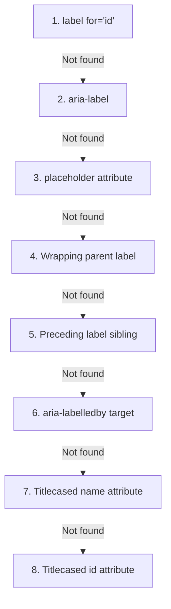

# Form Filling & Field Inspection

This document describes the automatic Form Discovery engine, zero-config autofill workflows, and DOM inspection mechanisms with visual badge overlays.

---

## 1. Overview & Purpose

Filling out web forms accurately is a core challenge in browser automation. The agent provides two integrated subsystems:
1. **Form Discovery Engine (`browser.form_discovery`)**: Automatically inspects the live DOM to discover form fields, infer human-readable labels, extract options, and fuzzy-match fields to user data.
2. **Form Filler (`browser.form_filler`)**: Executes high-level form workflows and provides zero-config autofill without requiring manual CSS selector configuration.
3. **Interactive Field Inspection (`browser.controller` & `browser.actions`)**: Scans interactive elements and overlays numbered badges directly on the webpage for visual tracking and planner reasoning.

---

## 2. Main Components & Files

| Component | File Location | Responsibility |
|---|---|---|
| **`FormDiscovery`** | `browser/form_discovery.py` | Scans DOM, classifies field types, resolves unique CSS selectors, infers labels, and builds data mappings. |
| **`FormFiller`** | `browser/form_filler.py` | High-level workflows (`login`, `register`, `fill_survey`, `apply_job`) and zero-config `autofill()`. |
| **DOM Inspection & Badges** | `browser/controller.py` | `parse_interactive_elements()` scans clickable/input controls and renders visual numbered badge overlays. |
| **Field State Primitives** | `browser/actions.py` | Direct inspection primitives: `get_text`, `get_attribute`, `get_input_value`, `is_visible`, `is_enabled`. |

---

## 3. Form Discovery Engine

`FormDiscovery` scans live Playwright pages and returns a structured `FormDiscoveryResult` in `models/schemas.py`.

### 3.1. 8-Source Label Inference Priority Chain
To determine the true human-readable purpose of each field, the engine evaluates DOM attributes in order:



### 3.2. Supported Field Types
The engine classifies controls into standardized `FieldType` enums:
- **Text & Numeric**: `text`, `email`, `password`, `number`, `tel`, `search`, `url`, `date`, `textarea`.
- **Selection Controls**: `dropdown` (with parsed `<option>` labels and values), `checkbox`, `radio` (deduplicated by group name).
- **Special Controls**: `file` (upload inputs), `hidden`, `submit`.

### 3.3. Zero-Config Data Auto-Mapping
`discover_and_map(page, user_data)` fuzzy-matches discovered fields to dictionary keys in `user_data` using:
1. Standard `autocomplete` tokens (`email`, `given-name`, `family-name`, `tel`, `street-address`, etc.).
2. Keyword matching rules across inferred labels, names, and placeholders.
3. Fallback field type heuristics (`FieldType.EMAIL` -> `email`, `FieldType.PASSWORD` -> `password`).

---

## 4. Form Filling Workflows (`FormFiller`)

### 4.1. Zero-Config Autofill
Automatically discovers all form fields on a page and fills them using matching keys from a user dictionary:

```python
from browser.form_filler import FormFiller

filler = FormFiller(page)
await filler.autofill(
    user_data={
        "first_name": "Jane",
        "last_name": "Doe",
        "email": "jane.doe@example.com",
        "phone": "+1-555-0199",
        "country": "Canada",
        "message": "Interested in enterprise pricing."
    },
    submit=True  # Automatically clicks the discovered submit button
)
```

### 4.2. Pre-Built Workflows
- **`login(username, password, ...)`**: Fills credentials and clicks login.
- **`register(field_mapping, user_data, ...)`**: Fills registration fields.
- **`apply_job(applicant_data, resume_path, ...)`**: Fills application form, attaches resume file, and submits.
- **`fill_survey(field_mapping, survey_answers, ...)`**: Fills survey questions.

---

## 5. Page & Field Inspection with Visual Badges

`BrowserController.parse_interactive_elements()` collects all interactive elements on the viewport and optionally renders numbered visual badges:

```python
# Scan DOM and inject visual badges (show_badges=True)
page_info = await controller.parse_interactive_elements()

# Access indexed element mapping
print(f"Page Title: {page_info['title']}")
for element in page_info["elements"]:
    print(f"[{element['index']}] {element['tag']} -> {element['text']} ({element['selector']})")

# Remove badges when task finishes
await controller.clear_badges()
```

---

## 6. Basic Usage: Form Discovery REST Endpoint

You can inspect form fields via the REST API endpoint:

```bash
curl -X POST http://localhost:8000/api/forms/discover \
  -H "Content-Type: application/json" \
  -d '{"url": "http://localhost:8000/test-form", "headless": true}'
```

**Response Preview**:
```json
{
  "url": "http://localhost:8000/test-form",
  "forms": [
    {
      "form_index": 0,
      "submit_selector": "#submit",
      "field_count": 4,
      "fields": [
        {
          "field_type": "text",
          "selector": "#userName",
          "label": "Full Name",
          "name": "userName"
        },
        {
          "field_type": "text",
          "selector": "#userEmail",
          "label": "Email",
          "name": "userEmail"
        }
      ]
    }
  ]
}
```

---

## 7. Current Limitations

1. **Custom Canvas / Non-Standard UI Widgets**: Forms built entirely with WebGL/Canvas elements (without standard DOM `<input>` or ARIA semantics) cannot be automatically discovered.
2. **Multi-Step Wizard Forms**: Dynamic wizard forms that reveal fields across multiple step clicks require sequential step progression rather than a single discovery pass.

---

## 8. Verification & Demos

You can run a live, headed demonstration of form discovery and auto-filling against a local HTML resource:

```bash
python scripts/demo_form_fill.py
```

This script:
1. Opens a visible Chromium window.
2. Loads a local test form (`tests/resources/form_demo.html`).
3. Runs the `FormDiscovery` engine to inspect the DOM and auto-map inputs to a mock user profile.
4. Auto-fills all input fields (including checkboxes, radio buttons, dropdown selects, and file attachments) in real-time.
