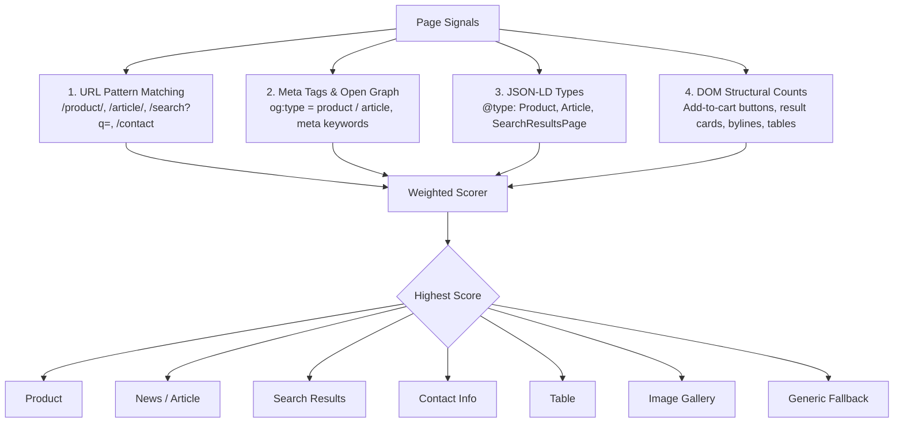

# Structured Information Extraction

This document describes the Information Extraction engine, automatic page category detection, and the 7 specialized extraction modules.

---

## 1. Overview & Purpose

Web pages come in widely varying structures (e-commerce listings, news articles, search engine result pages, contact pages, tabular data). The **Information Extraction Engine** (`browser/extractor.py` and `extraction/`) extracts clean, typed, structured data from any arbitrary web page.

Key capabilities:
- **Automatic Category Detection**: Uses a multi-signal scoring heuristic to classify the page into one of 7 categories.
- **Multi-Source Extraction Strategy**: Merges JSON-LD, Schema.org Microdata, site-specific selectors, and generic DOM heuristics.
- **Normalized Pydantic Schemas**: Returns JSON-serializable payloads typed to standardized schemas.

---

## 2. Main Components & Files

| Component | File Location | Responsibility |
|---|---|---|
| **`InfoExtractor`** | `browser/extractor.py` | Top-level facade orchestrating category classification, metadata extraction, and module dispatching. |
| **Product Extractor** | `extraction/product.py` | E-commerce extraction: price, original price, discount %, brand, rating, reviews, SKU, images, availability. |
| **News / Article Extractor** | `extraction/news.py` | Editorial content: headline, author byline, publication date, summary, and article body. |
| **Search Engine Extractor** | `extraction/search.py` | SERP results from Google, Bing, DuckDuckGo, Yahoo, and generic search engines. |
| **Contact Extractor** | `extraction/contact.py` | Emails, phone numbers, physical addresses, social media links, and Google Maps links. |
| **Table Extractor** | `extraction/tables.py` | HTML tables preserving headers, rows, and `rowspan`/`colspan` cell spans. |
| **Image Extractor** | `extraction/images.py` | Image galleries with dimensions, alt text, and thumbnail URLs. |
| **Metadata Extractor** | `extraction/metadata.py` | Open Graph, Twitter cards, meta descriptions, canonical URLs, language, and keywords. |

---

## 3. Page Category Auto-Detection Engine

When a URL is extracted without an explicit category, `InfoExtractor.detect_category()` calculates weighted scores across four signal categories:



---

## 4. Specialized Extraction Modules

### 4.1. Product Extraction (`ProductInfo` in `models/schemas.py`)
- **Sources**: JSON-LD `Product` schema -> Schema.org microdata -> Site-specific selectors (Amazon, eBay, Flipkart, Walmart, Shopify) -> Generic fallback.
- **Computed Fields**: Calculates `discount_percentage` automatically if current and original prices are found.

### 4.2. Search Results (`SearchResult` in `models/schemas.py`)
- **Engine Parsers**: Dedicated card parsers for Google (`.g`), Bing (`.b_algo`), DuckDuckGo (`[data-testid="result"]`), Yahoo (`#web .algo`), and generic fallback `<h3>` / `<h2>` anchors.
- **Data Captured**: Rank position, title, snippet description, destination URL, domain, and thumbnail.

### 4.3. News & Articles (`NewsArticle` in `models/schemas.py`)
- Extracts headline, author bylines, ISO publication dates (`<time datetime>`), article content body, section, and tags.

### 4.4. Contact Information (`ContactInfo` in `models/schemas.py`)
- Extracts unique deduplicated emails, international phone number patterns, business address, and maps social links (LinkedIn, Twitter/X, GitHub, Facebook, Instagram, YouTube).

### 4.5. HTML Tables (`TableData` in `models/schemas.py`)
- Preserves table structure, header rows (`<th>`), and cell span metadata (`rowspan`, `colspan`) inside `TableCell` objects.

---

## 5. Basic Usage

### Python Direct Extraction:
```python
from browser.pool import get_browser_pool
from browser.extractor import InfoExtractor

pool = await get_browser_pool()
async with pool.acquire_context() as (context, page):
    await page.goto("https://www.example.com/product/12345")
    
    extractor = InfoExtractor()
    result = await extractor.extract(page)  # category=None triggers auto-detection
    
    print(f"Detected Category: {result.category}")
    print(f"Page Title: {result.page_title}")
    print(f"Extracted Payload: {result.data}")
```

### REST API Endpoint (`POST /api/extract`):
```bash
curl -X POST http://localhost:8000/api/extract \
  -H "Content-Type: application/json" \
  -d '{
    "url": "https://news.ycombinator.com",
    "category": null,
    "headless": true
  }'
```

---

## 6. Current Limitations

1. **Client-Side Heavy Dynamic SPAs**: Pages that render content only after complex user gestures (e.g. infinite scroll triggers or button clicks) may require prior action navigation before calling extraction.
2. **Obfuscated Anti-Scraping Canvases**: Visual tables or text rendered inside HTML5 `<canvas>` elements cannot be parsed via DOM extraction.

---

## 7. Verification & Demos

You can run a live, headed demonstration of structured data extraction across different page categories (e-commerce products, news articles, search engine results, tables, galleries, and contact pages):

```bash
python scripts/demo_extraction.py
```

This script:
1. Opens a visible Chromium window.
2. Iterates through a set of predefined URLs (both local and public).
3. Executes direct programmatic `InfoExtractor` queries, with or without forced category overrides.
4. Outputs the structured metadata, classification category, and parsed payload in a formatted JSON schema directly to the console.
